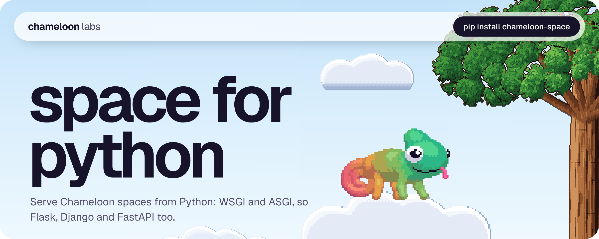
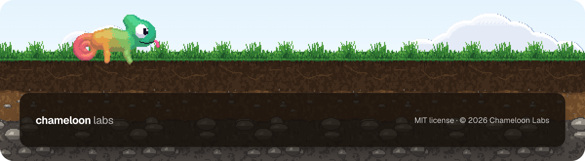

<a href="https://github.com/Chameloon-Labs/space-python"></a>

<p align="center">
  <a href="https://chameloon.com/docs/"></a>
  <a href="https://chameloon.com/docs/protocol/"></a>
</p>

The Python server SDK for Chameloon spaces. It serves space folders over HTTP, handles sync and device sign-in, and runs bots. It passes the Chameloon server [conformance suite](https://github.com/Chameloon-Labs/conformance), so the app works with it like with the TypeScript server.

## Install

```sh
pip install chameloon-space
```

Python 3.10 or newer. The only dependency is `cryptography`.

## Quick start

Make a folder with one sub-folder per space. A sub-folder is a space when it has a `space.json`.

```
spaces/
  todo/
    space.json
    pages/home.oui
```

Serve it:

```python
from chameloon_space import serve

serve("spaces", port=8787)
```

Or from the shell:

```sh
python -m chameloon_space serve spaces --port 8787
```

Add `http://<your address>:8787/todo` in the app. The server keeps its state in `server-data.json` inside each space, in the same format as the TypeScript server. A space can move between the two without losing data.

## Mount it in your web app

`create_app` returns one object that is both a WSGI and an ASGI app. It does not import any framework.

FastAPI or Starlette:

```python
from fastapi import FastAPI
from chameloon_space import create_app

api = FastAPI()
api.mount("/spaces", create_app("spaces"))
```

Flask:

```python
from flask import Flask
from werkzeug.middleware.dispatcher import DispatcherMiddleware
from chameloon_space import create_app

flask_app = Flask(__name__)
flask_app.wsgi_app = DispatcherMiddleware(flask_app.wsgi_app, {"/spaces": create_app("spaces")})
```

The phone signs the path it requests, so the mount prefix is part of what it signs. The app takes care of that.

Without a framework, `create_handler(root)` gives a plain function: `handler(method, path_with_query, headers, body_bytes)` returns `(status, headers, body_bytes)`.

## Write a bot

A bot reacts to what phones send and writes rows back. Put a `bot.py` in the space folder with any of these functions:

```python
def tick(store):
    """Runs on every sync before the pull is built."""

def on_op(op, store, device):
    """A change a phone sent. `op["op"]` is "upsert" or "delete"."""
    if op["op"] == "upsert" and op["table"] == "notes":
        store.put("replies", {"id": "re-" + op["row"]["id"], "text": "echo: " + op["row"]["text"]})

def on_event(event, data, store, device):
    """A page's Mutation("send", ...). Not stored as a row."""
    if event == "ping":
        store.notify("Ping", "from " + device)

def hook(body, store, headers):
    """POST /<space>/hook, called by another service. Check who is calling."""
    return {"ok": True}
```

`store` has `rows(table)`, `put(table, row)` and `notify(title, body)`. Rows need an `id`. Notifications go out through the push relay when the phone has one, and wait for the next sync otherwise.

You can also register bots in code. A bot is any object with those methods:

```python
create_app("spaces", bots={"echo": EchoBot()})
```

A bot registered in code wins over the space's `bot.py`.

## CLI

```sh
chameloon-serve-py spaces --port 8787 --token secret
chameloon-serve-py invite spaces todo --uses 3 --note "Anna's phone"
chameloon-serve-py devices spaces todo
chameloon-serve-py revoke spaces todo <key or phone id prefix>
```

`python -m chameloon_space` does the same. `serve` is the default command. `--uses` takes a number or `unlimited`. The port, folder and token can also come from the `PORT`, `SPACES` and `TOKEN` environment variables.

## Access

Set `auth` in a space's `space.json`:

- `"open"` (the default): anyone with the address can use the space.
- `"token"`: requests need `Authorization: Bearer <token>`. The token is `token` in the space's `auth.json`.
- `"device"`: every phone signs every request with its own key. A new phone brings an invite code once. A copied request cannot be replayed, and one phone can be revoked.

Create an invite with `chameloon-serve-py invite`. Phones that got in are listed in `auth.json` and with `devices`. With `--token` (or `TOKEN`), the whole server also needs one bearer token.

`auth.json` stays on the server and is never served.

## Links

- Docs: https://chameloon.com/docs/
- Protocol: https://chameloon.com/docs/protocol/

MIT license.

<br />

